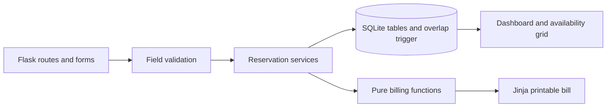

# Hotel Management System

A Flask and SQLite app connecting room availability, guest records, reservations, check-in and itemized billing.

Room assignments, arrival dates and bills need to stay consistent as a booking moves through its lifecycle. This application brings those operations into a local browser workspace. Users can inspect a room-by-date availability grid, create guest records, reserve a suitable room, check guests in and out, and print an itemized bill.

Availability checks and a database trigger reject overlapping active reservations. Explicit status transitions control booking actions, while integer-money calculations and reservation-time rate snapshots keep bills explainable. The first-run dataset contains synthetic guests and bookings for exploring the workflow.

The available code is a reconstruction written from a short description of an earlier hotel project. The earlier source is unavailable. This README documents the supplied implementation and preserves that distinction when describing its history.

[Run locally](#setup-on-windows-first-time) · [Feature walkthrough](#features) · [Architecture and booking rules](#engineering-the-booking-lifecycle) · [Tests](#running-the-tests) · [Recorded verification](docs/DOCUMENTATION_REVIEW.md)


## Contents

[Features](#features) · [Setup on Windows (first time)](#setup-on-windows-first-time) · [Using the app](#using-the-app) · [Running the tests](#running-the-tests) · [Project layout](#project-layout) · [Limitations](#limitations) · [Licence](#licence) · [Engineering the booking lifecycle](#engineering-the-booking-lifecycle)

## Features

| Area | What you can do |
|---|---|
| **Dashboard** | Today's room status board, occupied/available counts, arrivals, departures, guests in house, upcoming arrivals, latest bookings |
| **Rooms** | List rooms with number, type, capacity and nightly rate; add rooms; edit details; take a room out of service |
| **Guests** | Add, view, search (name, email, phone) and update guest records; see each guest's reservations |
| **Reservations** | Pick a guest, a room and dates; see which rooms are free for those dates (updates live); overlapping bookings for the same room are refused |
| **Status** | Confirmed → Checked in → Checked out, or Confirmed → Cancelled. Impossible changes are refused with a clear message |
| **Availability** | A rooms × dates grid (7, 14 or 28 days) showing which nights are taken |
| **Billing** | Room charge = rate × nights, plus extra charges, a separately shown service charge and tax, and a total. A printable bill page (use "Save as PDF" in the print window to keep a copy) |
| **Settings** | Hotel name, currency symbol, tax label, tax % and service charge % |

**Not included:** online payments. The bill is a record of charges only, and says so.

## Setup on Windows (first time)

1. **Install Python 3.10 or newer** from <https://www.python.org/downloads/>.
   On the first installer screen, tick **"Add python.exe to PATH"**.
2. **Open the project folder.** If you downloaded the ZIP: right-click it, choose **Extract All…**, then open
   the extracted `hotel-management-system` folder.
3. In File Explorer, click the address bar of that folder, type `cmd` and press Enter. A black Command Prompt
   window opens already inside the folder.
4. Run these commands one at a time:

```bat
py -m venv .venv
.venv\Scripts\activate
pip install -r requirements.txt
python app.py
```

5. Open <http://127.0.0.1:5000> in your browser.
6. To stop the app, click the Command Prompt window and press **Ctrl+C**.

**Next time**, you only need:

```bat
.venv\Scripts\activate
python app.py
```

**Shortcut:** double-click `run_windows.bat`. It creates the virtual environment and installs Flask the
first time, then starts the app. (This script was written without access to a Windows machine, so if it
misbehaves, use the commands above.)

**PowerShell users:** `.venv\Scripts\activate` may be blocked by the execution policy. Either use Command
Prompt (`cmd`), or skip activation and run `.venv\Scripts\python app.py` directly.

**If `py` is not recognised**, try `python` instead of `py`.

### macOS / Linux

```bash
python3 -m venv .venv
source .venv/bin/activate
pip install -r requirements.txt
python app.py
```

## Using the app

On the **very first run** the app creates `instance/hotel.db` and loads a small set of **synthetic demo
records** (11 rooms, 10 guests, 9 reservations with invented names, `example.com` emails and fictional
555-01xx phone numbers). Their dates are relative to the day you first ran the app.

A good first walk-through:

1. **Rooms → Add room.** Enter e.g. number `401`, type `Deluxe`, sleeps `2`, rate `8000`.
2. **Guests → Add guest.** Enter a name and phone number (email is optional).
3. **Reservations → New reservation.** Choose the guest, a check-in and check-out date, then pick a room
   from the list. Rooms that are booked, out of service or too small are greyed out with the reason.
4. **Try a conflict:** make a second booking for the same room on overlapping dates. It is refused with a
   message naming the existing reservation. Arriving on the day another guest *leaves* is allowed.
5. On the reservation page, click **View bill**. Use **Print or save as PDF**. Use **Add charge** on the
   reservation page to add items such as room service.
6. Use **Check in** (available from the arrival date), **Check out**, or **Cancel reservation**. A
   cancelled or checked-out booking frees the room.

### How a bill is calculated

```
room charge = nightly rate x nights            (the check-out night is not charged)
subtotal    = room charge + extra charges
service     = subtotal x service %             (rounded half-up to a cent)
tax         = (subtotal + service) x tax %     (rounded half-up to a cent)
total       = subtotal + service + tax
```

Example: 3 nights at 100.00 → 300.00; service 5 % = 15.00; tax 10 % of 315.00 = 31.50; **total 346.50**.
Money is stored as whole cents (integers), so there are no floating-point errors. The default 5 % service
and 10 % tax are **placeholder values** — change them on the **Settings** page. This is a simple demo model,
not tax advice.

The room rate, tax % and service % are **fixed on each reservation when it is created**, so later changes
to rates or settings never silently change an existing bill.

### Starting over / options

| Command | Effect |
|---|---|
| `python manage.py reset-demo` | Delete the database and reload the demo data (asks you to type YES) |
| `python manage.py reset-empty` | Delete the database and start with no data at all |
| `python manage.py seed-demo` | Add demo data if the database is empty |

Stop the app (Ctrl+C) before running reset commands. Optional environment variables: `HOTEL_PORT` (default
5000), `HOTEL_DB` (database file path), `HOTEL_NO_DEMO=1` (don't load demo data on first run). In Command
Prompt, set one like this: `set HOTEL_PORT=5001` then `python app.py`.

**Backup:** the whole database is the single file `instance/hotel.db`; copy it while the app is stopped.

## Running the tests

```bat
pip install -r requirements-dev.txt
python -m pytest
```

111 automated tests cover:

- **Billing maths** — nights, service charge, tax, rounding, extras, percentages, formatting
- **Validation** — required fields, dates (including impossible ones like `2026-02-30`), amounts, emails, phones
- **Overlap rules** — identical, partially overlapping, containing, first-night-only and last-night-only
  overlaps are refused; back-to-back stays, other rooms, and cancelled/checked-out stays are allowed; a
  database trigger independently blocks overlaps
- **Status rules** — allowed and refused transitions, check-in date rules, locked bills
- **The full workflow over HTTP** — add room and guest → reserve → conflicting booking refused → bill
  figures → extra charges → check-in/out/cancel, plus CSRF protection and HTML escaping

The workflow was also exercised by hand in a real browser (desktop and phone-sized screens).

## Project layout

```
app.py              start the web app
manage.py           reset / seed helper commands
requirements.txt    Flask
requirements-dev.txt  + pytest
hotel/
  __init__.py       app setup, CSRF protection, template helpers, error pages
  routes.py         web pages (thin: read input, call services, render)
  services.py       business rules: rooms, guests, availability, reservations, bills
  billing.py        pure bill calculation and money formatting
  validation.py     input cleaning and validation
  db.py, schema.sql SQLite connection and table definitions
  seed.py           synthetic demo data
  templates/        HTML (Jinja2)
  static/           CSS and a little JavaScript
tests/              pytest suite
```

## Limitations

- **No login or user accounts.** The app only listens on `127.0.0.1` (this computer). Do not expose it to
  a network or the internet as it is.
- Uses Flask's built-in development server — fine for local use, not a production deployment.
- One hotel, one currency, one tax rate and one service charge at a time.
- A reservation's dates can't be edited after creation; cancel it and make a new one.
- A bill is based on the booked nights; an early check-out does not shorten it.
- No payment handling or payment status, and no export other than printing / "Save as PDF".
- Rooms and guests can't be deleted (rooms can be taken out of service), to keep booking history intact.
- Developed and tested on Linux with Python 3.13 and a headless Chromium browser. The Windows steps above
  have not been run on a Windows machine. Accessibility has not been formally audited.

## Licence

A software licence has not been specified for this reconstruction. Public availability alone does not state reuse or redistribution terms. Obtain the appropriate rights-holder permission before redistributing or relicensing the code.

## Engineering the booking lifecycle

The application joins availability, guest records and billing around one operational question, whether a particular room can be assigned for a requested stay. A reservation captures its commercial terms when created, then moves through explicit states. This keeps room availability and the printed charge record connected to the same booking.



### Availability and status transitions

`hotel/services.py` keeps business operations separate from route rendering and accepts an open SQLite connection. Confirmed and checked-in reservations count as active. Date overlap excludes the checkout night, so one guest can depart on the next guest's arrival date. A database trigger supplies a second enforcement layer in addition to service checks.

The transition map allows confirmed bookings to become checked-in or cancelled, and checked-in bookings to become checked-out. Checked-out and cancelled states are terminal. Date and validation rules constrain those actions further. This structure makes the allowed lifecycle visible in one place and gives the tests concrete invariants to verify.

### Billing and historical consistency

`hotel/billing.py::compute_bill` is a pure function returning a structured `Bill`. Integer minor units represent amounts, while `Decimal` and half-up rounding apply percentages. Service is calculated on room charges plus extras, and tax is calculated after service. The bill's component fields make its total explainable on the printable page.

The booking captures nightly rate and percentage settings at creation. Later changes to hotel settings therefore apply to later bookings while existing records retain their agreed calculation inputs. An early checkout uses the booked nights under the current policy, which matters when interpreting a printed total.

### Demonstrated workflow and reproduction

The existing tests exercise room/guest creation, reservations, rejected conflicts, charges, bills and state transitions through service functions and HTTP requests. The test files separate arithmetic, validation, service behavior and the end-to-end route workflow. See the local documentation review record for checks rerun on 22 November 2026.

The first launch seeds synthetic records only when the database is empty. That makes the interface explorable without entering personal guest information. `HOTEL_NO_DEMO=1` supports an empty local start. The reset commands above replace local database contents and should be used only when that replacement is intended.

Further improvements can focus on editing reservation dates under the same overlap invariants and adding authenticated access if the deployment scope expands. The current reconstruction provenance remains important when describing this repository's relationship to the earlier unavailable project.

[22 November documentation checks](docs/DOCUMENTATION_REVIEW.md)
